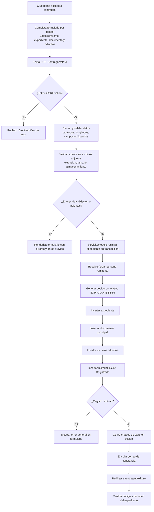
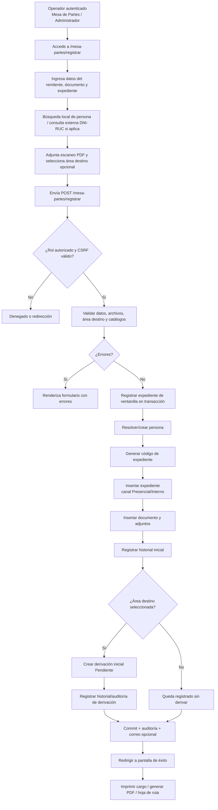
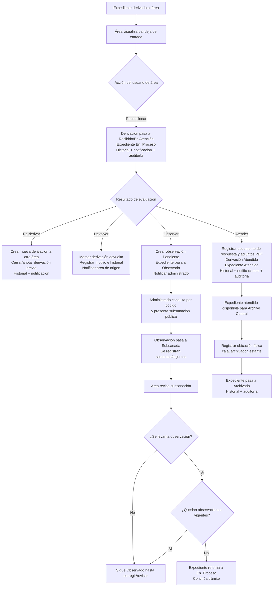
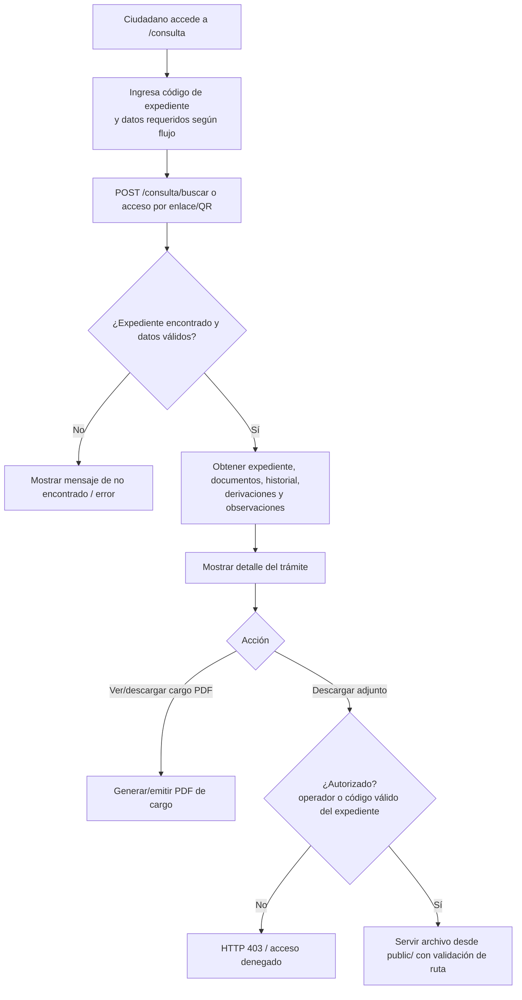
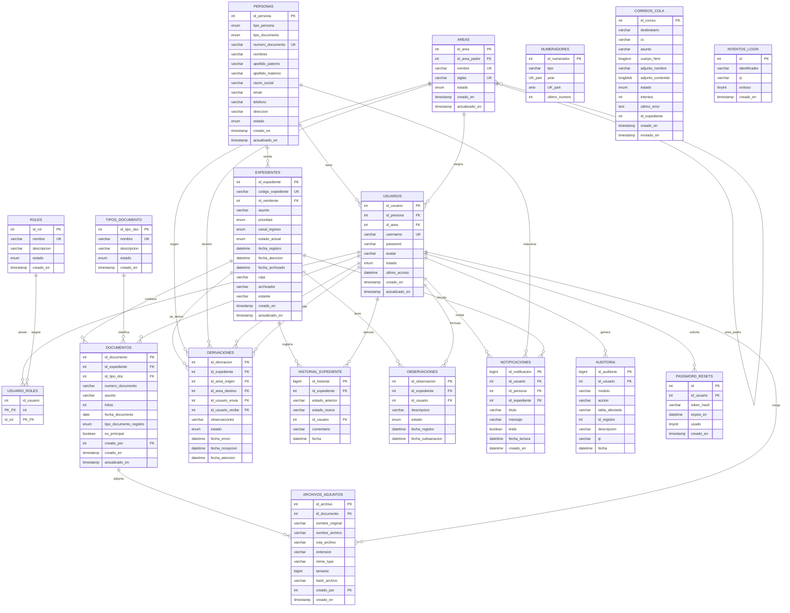

# Implementación del Sistema Web de Gestión Documentaria (Mesa Partes)

## 1. Descripción general

El **Sistema Web de Gestión Documentaria (Mesa de Partes)** de la Municipalidad Distrital de Lurín es una aplicación web orientada a digitalizar y centralizar el ciclo de vida del trámite documentario institucional. Permite el registro de expedientes por canales **virtual, presencial e interno**, su derivación entre áreas, la recepción y atención por parte de las oficinas responsables, el registro de observaciones y subsanaciones, la consulta pública del estado del trámite, la generación de cargos/hojas de ruta en PDF, el archivo físico centralizado, la emisión de notificaciones y reportes, así como la auditoría de las acciones realizadas en el sistema.

El sistema está diseñado con un **micro-framework MVC propio en PHP nativo** (sin Laravel/Symfony), acceso a datos mediante **PDO con consultas preparadas**, vistas en **PHP plano con AdminLTE 4/Bootstrap 5**, y persistencia en **MySQL/MariaDB**.

---

## 2. Tecnologías utilizadas

### 2.1 Backend
- **PHP 8.x** (aplicación principal y núcleo MVC propio).
- **Arquitectura MVC artesanal** con componentes propios:
  - `Src\Core\Router`: enrutamiento HTTP por método y URI con parámetros dinámicos.
  - `Src\Core\Controller`: renderizado de vistas/layouts, respuestas JSON, redirecciones y utilidades de entrada.
  - `Src\Core\Conexion`: conexión PDO Singleton.
  - `Src\Core\Request`, `Src\Core\Session`, `Src\Core\Validator`, `Src\Core\Dotenv`, `Src\Core\Path`: abstracciones de solicitud, sesión/autenticación, validación, variables de entorno y rutas.
- **PDO (MySQL)** para acceso a base de datos con consultas preparadas y transacciones.
- **Composer** para gestión de dependencias PHP.

### 2.2 Dependencias PHP (Composer)
| Paquete | Versión declarada | Uso principal |
|---|---|---|
| `vlucas/phpdotenv` | `^5.7` | Carga de variables de entorno desde `.env`. |
| `tecnickcom/tcpdf` | `~6.8.0` | Generación de documentos PDF (cargo de recepción, hoja de ruta, reportes) y códigos QR/2D. |
| `phpmailer/phpmailer` | `^7.2` | Envío de correos electrónicos (SMTP). |

### 2.3 Frontend
- **Vistas PHP planas** (`.php`) sin motor de plantillas tipo Blade.
- **AdminLTE 4** (sobre **Bootstrap 5.3**) como plantilla/base visual administrativa.
- **Bootstrap Icons** y **Font Awesome 6** para iconografía.
- **JavaScript** para interacciones de formularios, búsqueda en vivo, modales, DataTables/gráficos (según módulo/vista) y consumo de endpoints AJAX/JSON.
- **Chart.js** (referenciado en la arquitectura/vistas del dashboard) para visualización de indicadores.

### 2.4 Base de datos
- **MySQL 8.x** (compatible con MariaDB según documentación).
- Esquema relacional con claves foráneas, restricciones, índices, ENUMs y soporte **utf8mb4**.
- Script base: `db.sql`.
- Migraciones incrementales en `database/migrations/`.

### 2.5 Servidor, configuración y utilitarios
- **Servidor web Apache** con `mod_rewrite` (front controller en `index.php` / `.htaccess`).
- **Variables de entorno** (`.env`) para base de datos, zona horaria, URL de aplicación, correo y API externa.
- **Cola de correos** procesada por script CLI (`bin/procesar-correos.php`), ejecutable vía cron/Task Scheduler.
- **Integración externa (opcional/configurable):** API Decolecta (consulta RENIEC/SUNAT para autocompletado de datos por DNI/RUC).
- **Instalador web** (`/install`) para configuración inicial (requisitos, conexión BD, `.env`, importación de esquema y creación de usuario administrador).

### 2.6 Seguridad y soporte transversal (implementado en la base del proyecto)
- **Autenticación por sesión** (`Src\Core\Session`) y control de acceso por roles.
- **Protección CSRF** en formularios POST y peticiones AJAX (`App\Support\Csrf`, token en sesión/campo oculto/header).
- **Rate limiting/bloqueo de login** por intentos fallidos (tabla `intentos_login`).
- **Políticas de contraseña** reforzadas (longitud mínima y complejidad en flujos relevantes).
- **Recuperación de contraseña** con tokens con expiración y uso único (`password_resets`).
- **Auditoría** de acciones relevantes (`App\Models\Auditoria`, tabla `auditoria`).
- **Manejo centralizado de errores** (`App\Support\ManejadorErrores`).
- **Sanitización/validación** de entradas y catálogos/longitudes de campos.

---

## 3. Funcionalidades del sistema

### 3.1 Acceso, autenticación y seguridad
- Inicio y cierre de sesión con validación de credenciales y protección CSRF.
- Control de acceso basado en roles (menús, rutas y acciones condicionadas por perfil).
- Bloqueo temporal por intentos fallidos de login (rate limiting).
- Registro público de usuarios (flujo sujeto a asignación/gestión administrativa según configuración).
- Recuperación y restablecimiento de contraseña mediante enlace con token temporal.
- Rotación/gestión de token CSRF en sesión.

### 3.2 Gestión administrativa (catálogos y usuarios)
- **Usuarios:** listado, creación, edición, consulta, cambio de estado y eliminación (según implementación).
- **Personas (remitentes/ciudadanos):** registro y mantenimiento de datos de personas naturales/jurídicas; búsqueda y consulta por documento.
- **Áreas/Dependencias:** gestión de áreas institucionales (incluye jerarquía por área padre).
- **Roles:** administración de roles del sistema.
- **Tipos de documento:** administración del catálogo de tipos documentales.
- **Perfil de usuario:** consulta/gestión del perfil (módulo y rutas disponibles).

### 3.3 Registro y recepción de expedientes

#### 3.3.1 Mesa de Partes Virtual (ciudadanía, sin autenticación obligatoria)
- Formulario de presentación de trámites por pasos (`/entregas`).
- Registro de datos del remitente y del expediente/documento.
- Adjuntado de archivos (validaciones de extensión/tamaño según flujo).
- Generación de código correlativo de expediente (`EXP-AAAA-NNNNN`) mediante numerador.
- Registro de expediente, documento principal y archivos adjuntos en transacción.
- Registro en historial inicial del expediente.
- Pantalla de confirmación de registro exitoso.
- Encolado de correo de constancia (con datos/enlace de consulta y QR según plantilla/servicio).

#### 3.3.2 Registro en ventanilla (Mesa de Partes presencial/interno)
- Registro de expedientes por canal **Presencial** o **Interno** (`/mesa-partes/registrar`).
- Búsqueda en vivo de personas/remitentes y consulta por documento (BD local y, si aplica, servicio externo).
- Carga de documentos escaneados/adjuntos PDF.
- Derivación inicial opcional al área destino al momento del registro.
- Generación de cargo/constancia de recepción y hoja de ruta (vista/PDF).
- Bandeja operativa de Mesa de Partes con filtros, indicadores y acciones de derivación.

#### 3.3.3 Envío de documento por usuario autenticado
- Módulo para usuarios autenticados que permite registrar/envíar documentos (`/enviar-documento`), reutilizando datos de persona asociados a la cuenta cuando corresponde.

### 3.4 Bandeja de área y gestión documental interna
- Bandeja de entrada del área con pestañas/estados operativos (pendientes, en proceso, atendidos/devueltos, etc.).
- Recepción de derivaciones pendientes por el área destino.
- Re-derivación de expedientes a otras áreas con proveído/observaciones.
- Devolución de expedientes al área de origen con motivo obligatorio.
- Atención del expediente con emisión de documento de respuesta y adjuntos PDF.
- Actualización de estados de derivación y expediente, con trazabilidad e historial.
- Visualización de detalle de derivación/expediente y documentos asociados.
- Restricción de acceso por área y rol (con excepción administrativa según reglas).

### 3.5 Observaciones y subsanaciones
- Registro de observaciones por el área sobre expedientes recepcionados/en atención.
- Cambio de estado del expediente a **Observado** y generación de notificaciones relacionadas.
- Presentación pública de subsanaciones por el administrado (consulta por código, formulario y carga de sustento/adjuntos).
- Revisión de subsanaciones por el área y levantamiento de observaciones.
- Retorno del expediente al flujo de atención cuando corresponde (según estado y observaciones vigentes).

### 3.6 Consulta pública y trazabilidad
- Consulta pública de expedientes por código (y validaciones asociadas según flujo).
- Visualización de detalle del expediente: datos generales, documentos, adjuntos, historial, derivaciones y observaciones.
- Descarga/visualización de cargo PDF y descarga controlada de adjuntos (con reglas de autorización/posesión del código o perfil operativo).
- Módulo interno de trazabilidad para usuarios autenticados (`/trazabilidad`) con búsqueda por código y despliegue de historial/derivaciones/observaciones.

### 3.7 Archivo central
- Bandeja de archivo para expedientes **Atendidos/Archivados**.
- Registro de ubicación física (caja, archivador, estante).
- Filtros por año, área, código y estado.
- Reimpresión de cargo/documentos asociados desde el módulo de archivo.

### 3.8 Reportes y exportaciones
- Reportes documentarios con filtros por fechas, área, tipo, estado, canal y prioridad.
- Indicadores/resúmenes (totales, atendidos, pendientes, observados, archivados, SLA dentro/fuera de plazo, promedios, etc.).
- Agrupaciones para visualización analítica (por día/mes, área, tipo, estado, canal, prioridad, SLA por área).
- Exportación de resultados en **CSV** y **PDF**.
- Registro de auditoría de exportaciones.

### 3.9 Auditoría del sistema
- Visor de auditoría para perfil administrador.
- Filtros por rango de fechas, usuario, módulo, acción y texto.
- Paginación de resultados y consulta de detalle de registros.
- Catálogos auxiliares (módulos, acciones, usuarios) para filtrado.

### 3.10 Notificaciones y correo
- **Notificaciones web internas:** listado, contador de no leídas, marcado individual y masivo como leídas (consumo desde header/AJAX).
- Generación de notificaciones por eventos del flujo documental (derivaciones, recepciones, devoluciones, atenciones, observaciones/subsanaciones, etc.).
- **Cola de correos:** encolado de mensajes (HTML, CC, adjuntos/QR según caso) y procesamiento diferido por script CLI.
- Servicio de envío SMTP mediante PHPMailer con configuración por variables de entorno.

### 3.11 Instalación y puesta en marcha
- Asistente web de instalación inicial (si no existe `.env`/lock o BD no inicializada): verificación de requisitos, configuración de base de datos, generación de `.env`, importación de `db.sql`, creación de usuario administrador y bloqueo posterior del instalador.

---

## 4. Estructura del proyecto

### 4.1 Organización general (arquitectura)

El proyecto sigue una organización **MVC personalizada**:

- **Front Controller:** `index.php` inicializa autoload, entorno, zona horaria, manejo de errores y despacha rutas (modo normal o modo instalación).
- **Núcleo (`Src/Core/`):** componentes base reutilizables (router, conexión, sesión, request, validador, etc.).
- **Aplicación (`App/`):**
  - **Controllers:** orquestan solicitudes HTTP, validaciones, autorización, llamadas a modelos/servicios y renderizado de vistas o respuestas JSON.
  - **Models:** acceso a datos y lógica de persistencia/consultas por entidad o caso de uso.
  - **Services:** lógica de negocio y utilidades de dominio/integración desacopladas (p.ej. numeración/alta de expedientes, PDF, correo, consultas externas).
  - **Validators:** validaciones especializadas de formularios.
  - **Support:** utilidades transversales (CSRF, roles, catálogos, flash, manejo de errores, usuario actual, autorización).
- **Rutas (`routes/`):** definición modular de endpoints por dominio funcional y despacho central en `routes/Router.php`.
- **Vistas (`view/`):** layout maestro (`view/includes`) y páginas por módulo (`view/pages`), además de plantillas de correo (`view/emails`, según uso).
- **Configuración (`config/`):** parámetros de base de datos y correo leídos desde entorno.
- **Base de datos (`database/`):** migraciones incrementales; esquema base en `db.sql`.
- **Recursos públicos (`public/`):** assets y archivos cargados/adjuntos.
- **Scripts (`bin/`):** tareas operativas (procesamiento de cola de correos).

### 4.2 Flujo de ejecución (alto nivel)
1. La petición HTTP entra por `index.php`.
2. Se inicializa el entorno (`.env`), zona horaria y manejador de errores.
3. Se determina si el sistema está instalado; si no, se cargan rutas de instalación.
4. En modo normal se cargan las rutas del sistema y `Src\Core\Router` resuelve la acción controlador/método.
5. El controlador valida/autorización/procesa y responde con vista HTML, redirección o JSON.
6. Los modelos/servicios interactúan con MySQL (PDO) y servicios auxiliares (PDF, correo, API externa).

---

## 5. Estructura de archivos

> Nota: se presenta una estructura representativa basada en el contenido del repositorio (directorios y archivos principales identificados).

```text
mesa-partes-lurin/
├─ .clineignore
├─ .env
├─ .env.example
├─ .gitignore
├─ .htaccess
├─ index.php                         # Front controller / bootstrap de la aplicación
├─ autoload.php                      # Autoload del proyecto
├─ composer.json
├─ composer.lock
├─ db.sql                            # Esquema base de BD + datos iniciales y tablas auxiliares
├─ readme.md
├─ arquitectura.md
├─ spec.md
├─ tareas.md
├─ observaciones.md
├─ uso-validator.md
├─ SD.PHP
│
├─ App/
│  ├─ Controllers/
│  │  ├─ Concerns/
│  │  │  └─ AuthorizesRequest.php
│  │  ├─ ArchivoController.php
│  │  ├─ AreaController.php
│  │  ├─ AuditoriaController.php
│  │  ├─ AuthController.php
│  │  ├─ BandejaAreaController.php
│  │  ├─ ConsultaExpedienteController.php
│  │  ├─ DashboardController.php
│  │  ├─ EntregaController.php
│  │  ├─ EnvioDocumentoController.php
│  │  ├─ ErrorController.php
│  │  ├─ InstallController.php
│  │  ├─ LandingController.php
│  │  ├─ MesaPartesController.php
│  │  ├─ NotificacionController.php
│  │  ├─ ObservacionController.php
│  │  ├─ PerfilController.php
│  │  ├─ PersonaController.php
│  │  ├─ ReporteController.php
│  │  ├─ RolController.php
│  │  ├─ SubsanacionController.php
│  │  ├─ TipoDocumentoController.php
│  │  ├─ TrazabilidadController.php
│  │  └─ UsuarioController.php
│  ├─ Models/
│  │  ├─ Archivo.php
│  │  ├─ Area.php
│  │  ├─ Auditoria.php
│  │  ├─ ConsultaExpediente.php
│  │  ├─ CorreoCola.php
│  │  ├─ Dashboard.php
│  │  ├─ Derivacion.php
│  │  ├─ Documento.php
│  │  ├─ EntregaModel.php
│  │  ├─ InterfaceModel.php
│  │  ├─ MesaPartes.php
│  │  ├─ Notificacion.php
│  │  ├─ Observacion.php
│  │  ├─ Persona.php
│  │  ├─ Reporte.php
│  │  ├─ Rol.php
│  │  ├─ TipoDocumento.php
│  │  └─ Usuario.php
│  ├─ Services/
│  │  ├─ ApiDecolectaService.php
│  │  ├─ DocumentoLookupService.php
│  │  ├─ ExpedienteService.php
│  │  ├─ MailService.php
│  │  └─ PdfCargoService.php
│  ├─ Support/
│  │  ├─ Catalogos.php
│  │  ├─ Csrf.php
│  │  ├─ Flash.php
│  │  ├─ ManejadorErrores.php
│  │  ├─ Roles.php
│  │  └─ UsuarioActual.php
│  └─ Validators/
│     ├─ PersonaValidator.php
│     ├─ RolValidator.php
│     └─ UsuarioValidator.php
│
├─ Src/
│  └─ Core/
│     ├─ Conexion.php
│     ├─ Controller.php
│     ├─ Dotenv.php
│     ├─ Path.php
│     ├─ Request.php
│     ├─ Router.php
│     ├─ Session.php
│     └─ Validator.php
│
├─ routes/
│  ├─ Router.php                     # Carga de rutas y dispatch central
│  ├─ archivo.php
│  ├─ areas.php
│  ├─ auditoria.php
│  ├─ auth.php
│  ├─ bandeja_area.php
│  ├─ dashboard.php
│  ├─ entrega.php
│  ├─ error.php
│  ├─ install.php
│  ├─ mesa_partes.php
│  ├─ notificaciones.php
│  ├─ observaciones.php
│  ├─ perfil.php
│  ├─ personas.php
│  ├─ reportes.php
│  ├─ roles.php
│  ├─ tipos_documento.php
│  ├─ trazabilidad.php
│  └─ usuarios.php
│
├─ config/
│  ├─ database.php
│  └─ mail.php
│
├─ database/
│  └─ migrations/
│     ├─ 2026_11_19_archivo_central.sql
│     ├─ 2026_11_19_intentos_login.sql
│     ├─ 2026_11_20_password_resets.sql
│     └─ migration_utf8mb4.sql
│
├─ view/
│  ├─ includes/                      # Layout y parciales (app, head, header, sidebar, footer, scripts)
│  ├─ pages/
│  │  ├─ archivo/
│  │  ├─ area/
│  │  ├─ areas/
│  │  ├─ auditoria/
│  │  ├─ consulta/
│  │  ├─ dashboard/
│  │  │  └─ components/
│  │  ├─ entrega/
│  │  ├─ envio/
│  │  ├─ errors/
│  │  ├─ install/
│  │  ├─ mesa-partes/
│  │  ├─ observaciones/
│  │  ├─ perfil/
│  │  ├─ personas/
│  │  ├─ reportes/
│  │  ├─ roles/
│  │  ├─ tipo-documento/
│  │  ├─ trazabilidad/
│  │  └─ usuarios/
│  └─ emails/                        # Plantillas de correo (según implementación)
│
├─ public/
│  └─ uploads/                       # Archivos adjuntos y documentos subidos
│
├─ bin/
│  └─ procesar-correos.php           # Procesamiento de cola de correos (CLI)
│
├─ storage/
│  ├─ logs/                          # Logs de aplicación/errores
│  └─ installed.lock                 # Marca de instalación (si aplica)
│
└─ vendor/                           # Dependencias instaladas por Composer
```

---

## 6. Diagramas de flujo (apartados seleccionados)

### 6.1 Flujo de registro de expediente virtual (ciudadano)



### 6.2 Flujo de registro en ventanilla y derivación (Mesa de Partes)



### 6.3 Flujo de atención en área con observación, subsanación y archivo



### 6.4 Flujo de consulta pública y descarga de cargo



---

## 7. Base de datos

### 7.1 Consideraciones generales
- Motor: **MySQL/MariaDB** (InnoDB, `utf8mb4`).
- Esquema base definido en `db.sql` y complementado por migraciones en `database/migrations/`.
- Se utilizan claves primarias autoincrementales, claves foráneas con reglas de integridad referencial, índices para búsquedas frecuentes y campos ENUM para estados/catálogos controlados.
- Entidades transversales: `auditoria`, `notificaciones`, `historial_expediente`, `correos_cola`, `intentos_login`, `password_resets`.

### 7.2 Tablas detalladas

#### 7.2.1 `personas`
**Descripción:** almacena los datos de personas naturales o jurídicas (remitentes, ciudadanos, entidades).

| Campo | Tipo | Nulo | Predeterminado | Descripción / Restricción |
|---|---|---:|---|---|
| `id_persona` | INT | No | AI | PK. Identificador único de la persona. |
| `tipo_persona` | ENUM('Natural','Juridica') | No | `Natural` | Tipo de persona. |
| `tipo_documento` | ENUM('DNI','CE','RUC','Pasaporte','Otro') | No | `DNI` | Tipo de documento de identidad. |
| `numero_documento` | VARCHAR(20) | No | - | Número de documento. |
| `nombres` | VARCHAR(100) | Sí | NULL | Nombres (persona natural). |
| `apellido_paterno` | VARCHAR(100) | Sí | NULL | Apellido paterno. |
| `apellido_materno` | VARCHAR(100) | Sí | NULL | Apellido materno. |
| `razon_social` | VARCHAR(200) | Sí | NULL | Razón social (persona jurídica). |
| `email` | VARCHAR(150) | Sí | NULL | Correo electrónico. |
| `telefono` | VARCHAR(30) | Sí | NULL | Teléfono de contacto. |
| `direccion` | VARCHAR(255) | Sí | NULL | Dirección. |
| `estado` | ENUM('Activo','Inactivo') | No | `Activo` | Estado del registro. |
| `creado_en` | TIMESTAMP | No | `CURRENT_TIMESTAMP` | Fecha de creación. |
| `actualizado_en` | TIMESTAMP | No | `CURRENT_TIMESTAMP` | Fecha de actualización. |

**Índices/Restricciones:**
- `UNIQUE uk_persona_documento (tipo_documento, numero_documento)`
- `INDEX idx_personas_email (email)`

---

#### 7.2.2 `areas`
**Descripción:** catálogo de áreas/dependencias institucionales; permite jerarquía (área padre).

| Campo | Tipo | Nulo | Predeterminado | Descripción / Restricción |
|---|---|---:|---|---|
| `id_area` | INT | No | AI | PK. Identificador del área. |
| `id_area_padre` | INT | Sí | NULL | FK a `areas.id_area` (auto-relación jerárquica). |
| `nombre` | VARCHAR(100) | No | - | Nombre del área. |
| `siglas` | VARCHAR(20) | No | - | Siglas del área. |
| `estado` | ENUM('Activo','Inactivo') | No | `Activo` | Estado del área. |
| `creado_en` | TIMESTAMP | No | `CURRENT_TIMESTAMP` | Fecha de creación. |
| `actualizado_en` | TIMESTAMP | No | `CURRENT_TIMESTAMP` | Fecha de actualización. |

**Índices/Restricciones:**
- `UNIQUE uk_area_nombre (nombre)`
- `UNIQUE uk_area_siglas (siglas)`
- `FK (id_area_padre) REFERENCES areas(id_area) ON DELETE SET NULL ON UPDATE CASCADE`

---

#### 7.2.3 `roles`
**Descripción:** roles del sistema para control de acceso.

| Campo | Tipo | Nulo | Predeterminado | Descripción / Restricción |
|---|---|---:|---|---|
| `id_rol` | INT | No | AI | PK. Identificador del rol. |
| `nombre` | VARCHAR(50) | No | - | Nombre del rol (único). |
| `descripcion` | VARCHAR(255) | Sí | NULL | Descripción del rol. |
| `estado` | ENUM('Activo','Inactivo') | No | `Activo` | Estado del rol. |
| `creado_en` | TIMESTAMP | No | `CURRENT_TIMESTAMP` | Fecha de creación. |

**Índices/Restricciones:**
- `UNIQUE uk_rol_nombre (nombre)`

**Datos iniciales (seed):** `ADMINISTRADOR`, `MESA_DE_PARTES`, `RESPONSABLE_AREA`, `USUARIO_AREA`, `CONSULTA`.

---

#### 7.2.4 `usuarios`
**Descripción:** cuentas de acceso al sistema, vinculadas a una persona y opcionalmente a un área.

| Campo | Tipo | Nulo | Predeterminado | Descripción / Restricción |
|---|---|---:|---|---|
| `id_usuario` | INT | No | AI | PK. Identificador del usuario. |
| `id_persona` | INT | No | - | FK a `personas.id_persona`. |
| `id_area` | INT | Sí | NULL | FK a `areas.id_area` (área asignada). |
| `username` | VARCHAR(50) | No | - | Nombre de usuario (único). |
| `password` | VARCHAR(255) | No | - | Hash de contraseña. |
| `avatar` | VARCHAR(255) | Sí | `assets/img/default-user.png` | Ruta/identificador de avatar. |
| `estado` | ENUM('Activo','Inactivo','Suspendido') | No | `Activo` | Estado de la cuenta. |
| `ultimo_acceso` | DATETIME | Sí | NULL | Último acceso registrado. |
| `creado_en` | TIMESTAMP | No | `CURRENT_TIMESTAMP` | Fecha de creación. |
| `actualizado_en` | TIMESTAMP | No | `CURRENT_TIMESTAMP` | Fecha de actualización. |

**Índices/Restricciones:**
- `UNIQUE uk_usuario_username (username)`
- `FK (id_persona) REFERENCES personas(id_persona) ON DELETE RESTRICT ON UPDATE CASCADE`
- `FK (id_area) REFERENCES areas(id_area) ON DELETE SET NULL ON UPDATE CASCADE`

---

#### 7.2.5 `usuario_roles`
**Descripción:** relación N:M entre usuarios y roles.

| Campo | Tipo | Nulo | Predeterminado | Descripción / Restricción |
|---|---|---:|---|---|
| `id_usuario` | INT | No | - | PK compuesta / FK a `usuarios.id_usuario`. |
| `id_rol` | INT | No | - | PK compuesta / FK a `roles.id_rol`. |

**Índices/Restricciones:**
- `PRIMARY KEY (id_usuario, id_rol)`
- `FK (id_usuario) REFERENCES usuarios(id_usuario) ON DELETE CASCADE ON UPDATE CASCADE`
- `FK (id_rol) REFERENCES roles(id_rol) ON DELETE CASCADE ON UPDATE CASCADE`

---

#### 7.2.6 `tipos_documento`
**Descripción:** catálogo de tipos documentales usados en los documentos/expedientes.

| Campo | Tipo | Nulo | Predeterminado | Descripción / Restricción |
|---|---|---:|---|---|
| `id_tipo_doc` | INT | No | AI | PK. Identificador del tipo documental. |
| `nombre` | VARCHAR(100) | No | - | Nombre del tipo (único). |
| `descripcion` | VARCHAR(255) | Sí | NULL | Descripción. |
| `estado` | ENUM('Activo','Inactivo') | No | `Activo` | Estado. |
| `creado_en` | TIMESTAMP | No | `CURRENT_TIMESTAMP` | Fecha de creación. |

**Índices/Restricciones:**
- `UNIQUE uk_tipo_documento_nombre (nombre)`

**Datos iniciales (seed):** Solicitud, Oficio, Carta, Informe, Memorando, Resolución, Otros.

---

#### 7.2.7 `expedientes`
**Descripción:** entidad principal del trámite documentario; agrupa documentos, derivaciones, historial y estado global.

| Campo | Tipo | Nulo | Predeterminado | Descripción / Restricción |
|---|---|---:|---|---|
| `id_expediente` | INT | No | AI | PK. Identificador interno. |
| `codigo_expediente` | VARCHAR(30) | No | - | Código único de expediente (ej. `EXP-2026-00001`). |
| `id_remitente` | INT | No | - | FK a `personas.id_persona`. |
| `asunto` | VARCHAR(500) | No | - | Asunto/resumen del expediente. |
| `prioridad` | ENUM('Normal','Urgente') | No | `Normal` | Prioridad de atención. |
| `canal_ingreso` | ENUM('Virtual','Presencial','Interno') | No | `Virtual` | Canal de ingreso. |
| `estado_actual` | ENUM('Registrado','En_Proceso','Observado','Atendido','Archivado') | No | `Registrado` | Estado actual del expediente. |
| `fecha_registro` | DATETIME | No | `CURRENT_TIMESTAMP` | Fecha/hora de registro. |
| `fecha_atencion` | DATETIME | Sí | NULL | Fecha/hora de atención (cuando aplica). |
| `fecha_archivado` | DATETIME | Sí | NULL | Fecha/hora de archivado. |
| `caja` | VARCHAR(50) | Sí | NULL | Ubicación física: caja (archivo central). |
| `archivador` | VARCHAR(50) | Sí | NULL | Ubicación física: archivador. |
| `estante` | VARCHAR(50) | Sí | NULL | Ubicación física: estante. |
| `creado_en` | TIMESTAMP | No | `CURRENT_TIMESTAMP` | Fecha de creación. |
| `actualizado_en` | TIMESTAMP | No | `CURRENT_TIMESTAMP` | Fecha de actualización. |

**Índices/Restricciones:**
- `UNIQUE uk_codigo_expediente (codigo_expediente)`
- `INDEX idx_expediente_remitente (id_remitente)`
- `INDEX idx_expediente_estado (estado_actual)`
- `INDEX idx_expediente_fecha (fecha_registro)`
- `INDEX idx_expediente_archivado (fecha_archivado)` *(migración archivo central / presente en esquema consolidado)*
- `INDEX idx_expediente_ubicacion (caja, archivador, estante)` *(migración archivo central / presente en esquema consolidado)*
- `FK (id_remitente) REFERENCES personas(id_persona) ON DELETE RESTRICT ON UPDATE CASCADE`

---

#### 7.2.8 `documentos`
**Descripción:** documentos asociados a un expediente (ingresados, generados o de respuesta).

| Campo | Tipo | Nulo | Predeterminado | Descripción / Restricción |
|---|---|---:|---|---|
| `id_documento` | INT | No | AI | PK. Identificador del documento. |
| `id_expediente` | INT | No | - | FK a `expedientes.id_expediente`. |
| `id_tipo_doc` | INT | No | - | FK a `tipos_documento.id_tipo_doc`. |
| `numero_documento` | VARCHAR(100) | Sí | NULL | Número/código del documento. |
| `asunto` | VARCHAR(500) | No | - | Asunto del documento. |
| `folios` | INT | No | `1` | Cantidad de folios. |
| `fecha_documento` | DATE | Sí | NULL | Fecha del documento. |
| `tipo_documento_registro` | ENUM('Ingresado','Generado','Respuesta') | No | `Ingresado` | Clasificación del registro documental. |
| `es_principal` | BOOLEAN | No | `false` | Indica si es el documento principal del expediente. |
| `creado_por` | INT | Sí | NULL | FK a `usuarios.id_usuario` (usuario que registra). |
| `creado_en` | TIMESTAMP | No | `CURRENT_TIMESTAMP` | Fecha de creación. |
| `actualizado_en` | TIMESTAMP | No | `CURRENT_TIMESTAMP` | Fecha de actualización. |

**Índices/Restricciones:**
- `INDEX idx_documento_expediente (id_expediente)`
- `INDEX idx_documento_tipo (id_tipo_doc)`
- `FK (id_expediente) REFERENCES expedientes(id_expediente) ON DELETE CASCADE ON UPDATE CASCADE`
- `FK (id_tipo_doc) REFERENCES tipos_documento(id_tipo_doc) ON DELETE RESTRICT ON UPDATE CASCADE`
- `FK (creado_por) REFERENCES usuarios(id_usuario) ON DELETE SET NULL ON UPDATE CASCADE`

---

#### 7.2.9 `archivos_adjuntos`
**Descripción:** archivos físicos/digitales asociados a documentos (PDF, imágenes u otros según validación del flujo).

| Campo | Tipo | Nulo | Predeterminado | Descripción / Restricción |
|---|---|---:|---|---|
| `id_archivo` | INT | No | AI | PK. Identificador del archivo. |
| `id_documento` | INT | No | - | FK a `documentos.id_documento`. |
| `nombre_original` | VARCHAR(255) | No | - | Nombre original del archivo. |
| `nombre_archivo` | VARCHAR(255) | No | - | Nombre interno/almacenado. |
| `ruta_archivo` | VARCHAR(500) | No | - | Ruta relativa de almacenamiento. |
| `extension` | VARCHAR(20) | Sí | NULL | Extensión del archivo. |
| `mime_type` | VARCHAR(100) | Sí | NULL | Tipo MIME. |
| `tamanio` | BIGINT | Sí | NULL | Tamaño en bytes. |
| `hash_archivo` | VARCHAR(64) | Sí | NULL | Hash (integridad/identificación). |
| `creado_por` | INT | Sí | NULL | FK a `usuarios.id_usuario` (si aplica). |
| `creado_en` | TIMESTAMP | No | `CURRENT_TIMESTAMP` | Fecha de carga/registro. |

**Índices/Restricciones:**
- `INDEX idx_archivo_documento (id_documento)`
- `FK (id_documento) REFERENCES documentos(id_documento) ON DELETE CASCADE ON UPDATE CASCADE`
- `FK (creado_por) REFERENCES usuarios(id_usuario) ON DELETE SET NULL ON UPDATE CASCADE`

---

#### 7.2.10 `derivaciones`
**Descripción:** movimientos del expediente entre áreas (envío, recepción, atención, devolución, etc.).

| Campo | Tipo | Nulo | Predeterminado | Descripción / Restricción |
|---|---|---:|---|---|
| `id_derivacion` | INT | No | AI | PK. Identificador de la derivación. |
| `id_expediente` | INT | No | - | FK a `expedientes.id_expediente`. |
| `id_area_origen` | INT | No | - | FK a `areas.id_area` (área que envía). |
| `id_area_destino` | INT | No | - | FK a `areas.id_area` (área que recibe). |
| `id_usuario_envia` | INT | No | - | FK a `usuarios.id_usuario` (emisor). |
| `id_usuario_recibe` | INT | Sí | NULL | FK a `usuarios.id_usuario` (receptor). |
| `observaciones` | VARCHAR(1000) | Sí | NULL | Proveído, instrucciones o notas de la derivación. |
| `estado` | ENUM('Pendiente','Recibido','En_Atencion','Atendido','Devuelto') | No | `Pendiente` | Estado de la derivación. |
| `fecha_envio` | DATETIME | No | `CURRENT_TIMESTAMP` | Fecha/hora de envío. |
| `fecha_recepcion` | DATETIME | Sí | NULL | Fecha/hora de recepción. |
| `fecha_atencion` | DATETIME | Sí | NULL | Fecha/hora de atención/cierre de derivación. |

**Índices/Restricciones:**
- `INDEX idx_derivacion_expediente (id_expediente)`
- `INDEX idx_derivacion_destino (id_area_destino)`
- `INDEX idx_derivacion_estado (estado)`
- FKs:
  - `(id_expediente) -> expedientes(id_expediente)` ON DELETE CASCADE ON UPDATE CASCADE
  - `(id_area_origen) -> areas(id_area)` ON DELETE RESTRICT ON UPDATE CASCADE
  - `(id_area_destino) -> areas(id_area)` ON DELETE RESTRICT ON UPDATE CASCADE
  - `(id_usuario_envia) -> usuarios(id_usuario)` ON DELETE RESTRICT ON UPDATE CASCADE
  - `(id_usuario_recibe) -> usuarios(id_usuario)` ON DELETE SET NULL ON UPDATE CASCADE

---

#### 7.2.11 `historial_expediente`
**Descripción:** bitácora de cambios/estados y eventos relevantes del expediente (trazabilidad).

| Campo | Tipo | Nulo | Predeterminado | Descripción / Restricción |
|---|---|---:|---|---|
| `id_historial` | BIGINT | No | AI | PK. Identificador del evento. |
| `id_expediente` | INT | No | - | FK a `expedientes.id_expediente`. |
| `estado_anterior` | VARCHAR(30) | Sí | NULL | Estado previo (si aplica). |
| `estado_nuevo` | VARCHAR(30) | No | - | Estado/resultante registrado. |
| `id_usuario` | INT | Sí | NULL | FK a `usuarios.id_usuario` (actor). |
| `comentario` | VARCHAR(1000) | Sí | NULL | Descripción del evento. |
| `fecha` | DATETIME | No | `CURRENT_TIMESTAMP` | Fecha/hora del evento. |

**Índices/Restricciones:**
- `INDEX idx_historial_expediente (id_expediente)`
- `INDEX idx_historial_fecha (fecha)`
- FKs:
  - `(id_expediente) -> expedientes(id_expediente)` ON DELETE CASCADE ON UPDATE CASCADE
  - `(id_usuario) -> usuarios(id_usuario)` ON DELETE SET NULL ON UPDATE CASCADE

---

#### 7.2.12 `observaciones`
**Descripción:** observaciones formuladas al expediente y su ciclo de subsanación/levantamiento.

| Campo | Tipo | Nulo | Predeterminado | Descripción / Restricción |
|---|---|---:|---|---|
| `id_observacion` | INT | No | AI | PK. Identificador de la observación. |
| `id_expediente` | INT | No | - | FK a `expedientes.id_expediente`. |
| `id_usuario` | INT | No | - | FK a `usuarios.id_usuario` (usuario que observa). |
| `descripcion` | VARCHAR(1000) | No | - | Detalle de la observación/requerimiento. |
| `estado` | ENUM('Pendiente','Subsanada','Levantada') | No | `Pendiente` | Estado de la observación. |
| `fecha_registro` | DATETIME | No | `CURRENT_TIMESTAMP` | Fecha/hora de registro. |
| `fecha_subsanacion` | DATETIME | Sí | NULL | Fecha/hora de subsanación. |

**Índices/Restricciones:**
- `INDEX idx_observacion_expediente (id_expediente)`
- `INDEX idx_observacion_estado (estado)`
- FKs:
  - `(id_expediente) -> expedientes(id_expediente)` ON DELETE CASCADE ON UPDATE CASCADE
  - `(id_usuario) -> usuarios(id_usuario)` ON DELETE RESTRICT ON UPDATE CASCADE

---

#### 7.2.13 `notificaciones`
**Descripción:** notificaciones internas dirigidas a usuarios y/o personas, vinculadas o no a expedientes.

| Campo | Tipo | Nulo | Predeterminado | Descripción / Restricción |
|---|---|---:|---|---|
| `id_notificacion` | BIGINT | No | AI | PK. Identificador de la notificación. |
| `id_usuario` | INT | Sí | NULL | FK a `usuarios.id_usuario` (destinatario interno). |
| `id_persona` | INT | Sí | NULL | FK a `personas.id_persona` (persona relacionada). |
| `id_expediente` | INT | Sí | NULL | FK a `expedientes.id_expediente`. |
| `titulo` | VARCHAR(200) | No | - | Título breve. |
| `mensaje` | VARCHAR(1000) | No | - | Contenido del mensaje. |
| `leida` | BOOLEAN | No | `false` | Indicador de lectura. |
| `fecha_lectura` | DATETIME | Sí | NULL | Fecha/hora de lectura. |
| `creado_en` | DATETIME | No | `CURRENT_TIMESTAMP` | Fecha/hora de creación. |

**Índices/Restricciones:**
- `INDEX idx_notificacion_usuario (id_usuario)`
- `INDEX idx_notificacion_persona (id_persona)`
- `INDEX idx_notificacion_expediente (id_expediente)`
- FKs:
  - `(id_usuario) -> usuarios(id_usuario)` ON DELETE CASCADE ON UPDATE CASCADE
  - `(id_persona) -> personas(id_persona)` ON DELETE CASCADE ON UPDATE CASCADE
  - `(id_expediente) -> expedientes(id_expediente)` ON DELETE CASCADE ON UPDATE CASCADE

---

#### 7.2.14 `numeradores`
**Descripción:** control de correlativos por tipo y año (generación de códigos de expediente).

| Campo | Tipo | Nulo | Predeterminado | Descripción / Restricción |
|---|---|---:|---|---|
| `id_numerador` | INT | No | AI | PK. Identificador del numerador. |
| `tipo` | VARCHAR(50) | No | - | Tipo de correlativo (ej. `EXPEDIENTE`). |
| `anio` | YEAR | No | - | Año del correlativo. |
| `ultimo_numero` | INT | No | `0` | Último número emitido. |

**Índices/Restricciones:**
- `UNIQUE uk_numerador (tipo, anio)`

**Dato inicial (seed):** `(EXPEDIENTE, 2026, 0)`.

---

#### 7.2.15 `auditoria`
**Descripción:** registro de acciones del sistema para trazabilidad administrativa y de seguridad.

| Campo | Tipo | Nulo | Predeterminado | Descripción / Restricción |
|---|---|---:|---|---|
| `id_auditoria` | BIGINT | No | AI | PK. Identificador del evento de auditoría. |
| `id_usuario` | INT | Sí | NULL | FK a `usuarios.id_usuario` (actor, si aplica). |
| `modulo` | VARCHAR(100) | No | - | Módulo funcional afectado. |
| `accion` | VARCHAR(50) | No | - | Acción realizada (crear, editar, derivar, imprimir, etc.). |
| `tabla_afectada` | VARCHAR(100) | Sí | NULL | Tabla principal afectada. |
| `id_registro` | INT | Sí | NULL | ID del registro afectado. |
| `descripcion` | VARCHAR(1000) | Sí | NULL | Detalle del evento. |
| `ip` | VARCHAR(45) | Sí | NULL | Dirección IP origen. |
| `fecha` | DATETIME | No | `CURRENT_TIMESTAMP` | Fecha/hora del evento. |

**Índices/Restricciones:**
- `INDEX idx_auditoria_usuario (id_usuario)`
- `INDEX idx_auditoria_fecha (fecha)`
- `INDEX idx_auditoria_modulo (modulo)`
- `FK (id_usuario) REFERENCES usuarios(id_usuario) ON DELETE SET NULL ON UPDATE CASCADE`

---

#### 7.2.16 `correos_cola`
**Descripción:** cola de correos salientes para procesamiento asíncrono/diferido.

| Campo | Tipo | Nulo | Predeterminado | Descripción / Restricción |
|---|---|---:|---|---|
| `id_correo` | INT | No | AI | PK. Identificador del correo en cola. |
| `destinatario` | VARCHAR(150) | No | - | Correo destinatario principal. |
| `cc` | VARCHAR(150) | Sí | NULL | Copia (CC), si aplica. |
| `asunto` | VARCHAR(200) | No | - | Asunto del mensaje. |
| `cuerpo_html` | LONGTEXT | No | - | Contenido HTML del mensaje. |
| `adjunto_nombre` | VARCHAR(200) | Sí | NULL | Nombre de adjunto/recurso asociado (según uso). |
| `adjunto_contenido` | LONGBLOB | Sí | NULL | Contenido binario/base64 procesado según implementación del envío. |
| `estado` | ENUM('Pendiente','Enviado','Error') | No | `Pendiente` | Estado de procesamiento. |
| `intentos` | INT | No | `0` | Número de intentos realizados. |
| `ultimo_error` | TEXT | Sí | NULL | Último error registrado. |
| `id_expediente` | INT | Sí | NULL | Expediente relacionado (referencia lógica). |
| `creado_en` | TIMESTAMP | No | `CURRENT_TIMESTAMP` | Fecha de encolado. |
| `enviado_en` | TIMESTAMP | Sí | NULL | Fecha de envío exitoso. |

**Índices/Restricciones:**
- `INDEX idx_estado (estado)`
- `INDEX idx_creado (creado_en)`

---

#### 7.2.17 `intentos_login`
**Descripción:** registro de intentos de autenticación para control de bloqueo/rate limiting.

| Campo | Tipo | Nulo | Predeterminado | Descripción / Restricción |
|---|---|---:|---|---|
| `id` | INT | No | AI | PK. Identificador del intento. |
| `identificador` | VARCHAR(100) | No | - | Usuario/identificador de login. |
| `ip` | VARCHAR(45) | No | - | Dirección IP origen. |
| `exitoso` | TINYINT(1) | No | `0` | Indicador de éxito (1) o fallo (0). |
| `creado_en` | TIMESTAMP | No | `CURRENT_TIMESTAMP` | Fecha/hora del intento. |

**Índices/Restricciones:**
- `INDEX idx_intentos_ident_ip (identificador, ip, creado_en)`

---

#### 7.2.18 `password_resets`
**Descripción:** tokens para recuperación/restablecimiento de contraseña.

| Campo | Tipo | Nulo | Predeterminado | Descripción / Restricción |
|---|---|---:|---|---|
| `id` | INT | No | AI | PK. Identificador del registro. |
| `id_usuario` | INT | No | - | FK a `usuarios.id_usuario`. |
| `token_hash` | VARCHAR(64) | No | - | Hash del token de recuperación. |
| `expira_en` | DATETIME | No | - | Fecha/hora de expiración. |
| `usado` | TINYINT(1) | No | `0` | Indicador de uso del token. |
| `creado_en` | TIMESTAMP | No | `CURRENT_TIMESTAMP` | Fecha de creación. |

**Índices/Restricciones:**
- `INDEX idx_token_hash (token_hash)`
- `INDEX idx_usuario (id_usuario)`
- `FK (id_usuario) REFERENCES usuarios(id_usuario) ON DELETE CASCADE`

---

### 7.3 Resumen de relaciones principales (integridad referencial)

| Tabla origen | Campo(s) | Tabla destino | Cardinalidad | Regla referencial |
|---|---|---|---|---|
| `areas` | `id_area_padre` | `areas` | N:1 (auto) | `SET NULL` / `CASCADE` |
| `usuarios` | `id_persona` | `personas` | N:1 | `RESTRICT` / `CASCADE` |
| `usuarios` | `id_area` | `areas` | N:1 (opcional) | `SET NULL` / `CASCADE` |
| `usuario_roles` | `id_usuario` | `usuarios` | N:M (detalle) | `CASCADE` / `CASCADE` |
| `usuario_roles` | `id_rol` | `roles` | N:M (detalle) | `CASCADE` / `CASCADE` |
| `expedientes` | `id_remitente` | `personas` | N:1 | `RESTRICT` / `CASCADE` |
| `documentos` | `id_expediente` | `expedientes` | N:1 | `CASCADE` / `CASCADE` |
| `documentos` | `id_tipo_doc` | `tipos_documento` | N:1 | `RESTRICT` / `CASCADE` |
| `documentos` | `creado_por` | `usuarios` | N:1 (opcional) | `SET NULL` / `CASCADE` |
| `archivos_adjuntos` | `id_documento` | `documentos` | N:1 | `CASCADE` / `CASCADE` |
| `archivos_adjuntos` | `creado_por` | `usuarios` | N:1 (opcional) | `SET NULL` / `CASCADE` |
| `derivaciones` | `id_expediente` | `expedientes` | N:1 | `CASCADE` / `CASCADE` |
| `derivaciones` | `id_area_origen` | `areas` | N:1 | `RESTRICT` / `CASCADE` |
| `derivaciones` | `id_area_destino` | `areas` | N:1 | `RESTRICT` / `CASCADE` |
| `derivaciones` | `id_usuario_envia` | `usuarios` | N:1 | `RESTRICT` / `CASCADE` |
| `derivaciones` | `id_usuario_recibe` | `usuarios` | N:1 (opcional) | `SET NULL` / `CASCADE` |
| `historial_expediente` | `id_expediente` | `expedientes` | N:1 | `CASCADE` / `CASCADE` |
| `historial_expediente` | `id_usuario` | `usuarios` | N:1 (opcional) | `SET NULL` / `CASCADE` |
| `observaciones` | `id_expediente` | `expedientes` | N:1 | `CASCADE` / `CASCADE` |
| `observaciones` | `id_usuario` | `usuarios` | N:1 | `RESTRICT` / `CASCADE` |
| `notificaciones` | `id_usuario` | `usuarios` | N:1 (opcional) | `CASCADE` / `CASCADE` |
| `notificaciones` | `id_persona` | `personas` | N:1 (opcional) | `CASCADE` / `CASCADE` |
| `notificaciones` | `id_expediente` | `expedientes` | N:1 (opcional) | `CASCADE` / `CASCADE` |
| `auditoria` | `id_usuario` | `usuarios` | N:1 (opcional) | `SET NULL` / `CASCADE` |
| `password_resets` | `id_usuario` | `usuarios` | N:1 | `CASCADE` / (definida en tabla) |

> Nota: `correos_cola` incluye `id_expediente` como referencia contextual; en el esquema base provisto no se define FK explícita a `expedientes`.

---

## 8. Diagrama Entidad-Relación (ER)



---

## 9. Observaciones para la documentación posterior

- Este documento sirve como **base técnica y funcional** para elaborar artefactos adicionales (diagramas de casos de uso, diagramas de secuencia, manuales de usuario/administrador, matriz de trazabilidad, etc.).
- Para casos de uso, se recomienda derivarlos de los módulos y flujos descritos (registro virtual/presencial, derivación, recepción, atención, observación/subsanación, consulta, archivo, reportes, auditoría y administración).
- Se sugiere complementar con capturas de interfaz, reglas de negocio institucionales específicas y procedimientos operativos internos (SLA, plazos legales, formatos oficiales) según el contexto normativo de la entidad.
- Los diagramas Mermaid incluidos pueden renderizarse en visores compatibles (GitHub, editores Markdown con soporte Mermaid, MkDocs, etc.) o exportarse a imagen para anexarlos a documentación formal.
