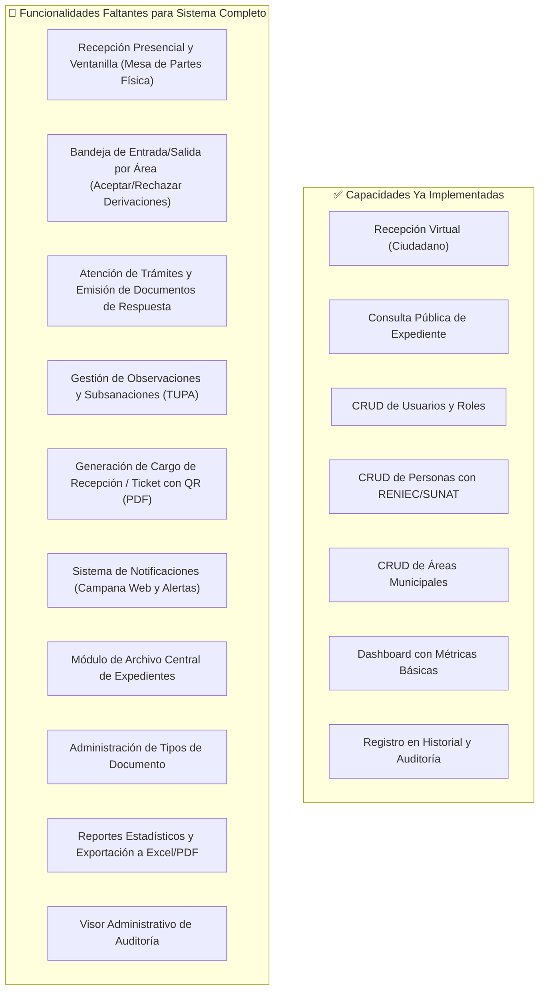

# 📋 Análisis Funcional y Plan de Tareas Pendientes — Mesa de Partes Lurín

> **Documento:** `tareas.md`  
> **Sistema:** Sistema de Trámite Documentario y Mesa de Partes — Municipalidad de Lurín  
> **Referencia Técnica:** Esquema de Base de Datos `db.sql` y Guía de Arquitectura `arquitectura.md`  
> **Fecha:** 04 de Noviembre de 2026

---

## 📌 1. Diagnóstico del Sistema: Lo que Existe vs. Lo que Falta

A partir del análisis exhaustivo del esquema relacional en `db.sql` y el código fuente en `App/`, se contrastan las capacidades actuales del software frente a las exigencias operativas de una **Mesa de Partes Municipal formal**:



### Tabla Comparativa por Tabla de Base de Datos

| Tabla en `db.sql`      | Estado en Código Actual                        | Brecha / Funcionalidad Faltante                                                                                                                    |
| ---------------------- | ---------------------------------------------- | -------------------------------------------------------------------------------------------------------------------------------------------------- |
| `expedientes`          | Parcial (solo `canal_ingreso = 'Virtual'`)     | Falta registro `Presencial` (con foliatura física) e `Interno` (entre áreas). Falta ciclo de vida completo (`Observado`, `Atendido`, `Archivado`). |
| `documentos`           | Parcial (solo documento inicial del ciudadano) | Falta registrar documentos generados internamente (`tipo_documento_registro`: `Generado`, `Respuesta`) como informes o memorandos.                 |
| `archivos_adjuntos`    | Implementado (subida en recepción)             | Falta previsualizador integrado (PDF viewer) y adjuntos en respuestas.                                                                             |
| `derivaciones`         | Muy básico (`DerivacionController` legacy)     | **No existe Bandeja de Entrada de Área**: los usuarios de área no pueden _recibir_, _atender_ ni _devolver_ derivaciones.                          |
| `observaciones`        | 🔴 **Sin implementar**                         | No hay interfaz para observar expedientes por falta de requisitos ni módulo de subsanación.                                                        |
| `historial_expediente` | Parcial (solo inserción inicial)               | Debe actualizarse automáticamente ante cada cambio de estado (observado, recibido, atendido, archivado).                                           |
| `notificaciones`       | 🔴 **Sin implementar**                         | No hay lógica ni interfaz para notificar a los usuarios internos o al administrado.                                                                |
| `tipos_documento`      | Solo consulta en dropdowns                     | Falta módulo CRUD administrativo para crear nuevos tipos de documentos.                                                                            |
| `auditoria`            | Solo inserción                                 | Falta pantalla de consulta y filtros para el Administrador.                                                                                        |
| `numeradores`          | Implementado para expedientes                  | Listo (se puede extender para numerar documentos internos si se requiere).                                                                         |

---

## 🎯 2. Matriz de Épicas y Tareas Priorizadas

| ID      | Épica / Módulo                                                         | Prioridad  | Complejidad |
| ------- | ---------------------------------------------------------------------- | ---------- | ----------- | ------------------- |
| **E01** | Bandeja de Gestión Documental de Áreas (Recepción, Atención, Rechazo)  | 🔴 Crítica | Alta        | (E01-1 ✅ E01-2 ✅) |
| **E02** | Recepción Presencial e Interna en Ventanilla (Mesa de Partes Operador) | 🔴 Crítica | Alta        | (E02-1 ✅ E02-2 ✅) |
| **E03** | Generación de Cargo de Recepción e Impresión de Ticket con QR          | 🟠 Alta    | Media       |
| **E04** | Ciclo de Atención y Emisión de Documento de Respuesta                  | 🟠 Alta    | Media       | (E04-1 ✅) |
| **E05** | Módulo de Observaciones y Subsanaciones de Requisitos                  | 🟠 Alta    | Media       | (E05-1 ✅) |
| **E06** | Bandeja de Archivo Central y Cierre de Expedientes                     | 🟡 Media   | Baja        |
| **E07** | CRUD Administrativo de Tipos de Documento                              | 🟡 Media   | Baja        |
| **E08** | Sistema de Notificaciones Web (Campanita en Header)                    | 🟡 Media   | Media       |
| **E09** | Reportes Documentarios e Indicadores de Cumplimiento (SLA)             | 🟡 Media   | Media       |
| **E10** | Visor de Auditoría del Sistema                                         | 🟢 Baja    | Baja        |

---

## 📝 3. Desglose Detallado de Tareas Técnicas

---

### ÉPICA 1: Bandeja de Gestión Documental de Áreas (Trabajo Diario)

> **Problema:** Actualmente las áreas no tienen interfaz para trabajar los expedientes que les derivan; la derivación muere en base de datos.

#### 📌 TAREA E01-1: Bandeja de Entrada del Área (`/area/bandeja-entrada`) ✅ [Completada]

- **Descripción:** Pantalla para los roles `RESPONSABLE_AREA` y `USUARIO_AREA` que lista los expedientes derivados a su área.
- **Pestañas/Filtros requeridos:**
  1. _Pendientes de Recepción_ (`derivaciones.estado = 'Pendiente'`).
  2. _En Proceso / En Atención_ (`derivaciones.estado = 'Recibido'` o `'En_Atencion'`).
  3. _Atendidos / Devueltos_.
- **Acciones operativas:**
  - **Botón "Recepcionar":** Actualiza `derivaciones.estado = 'Recibido'`, asigna `derivaciones.id_usuario_recibe = id_usuario_actual`, `fecha_recepcion = NOW()`, actualiza `expedientes.estado_actual = 'En_Proceso'`, e inserta en `historial_expediente`.
  - **Botón "Rechazar / Devolver":** Solicita motivo obligatorio, actualiza `derivaciones.estado = 'Devuelto'` y devuelve el expediente al área de origen.
- **Archivos a crear/modificar:**
  - `App/Controllers/BandejaAreaController.php`
  - `App/Models/Derivacion.php` (métodos `recepcionar()`, `devolver()`, `listarPorArea()`)
  - `routes/area.php`
  - `view/pages/area/bandeja.php`
  - `view/includes/sidebar.php` (enlazar a la ruta real)

#### 📌 TAREA E01-2: Re-derivación entre Áreas (`/area/derivar`) ✅ [Completada]

- **Descripción:** Permitir que un área receptora pueda derivar el expediente a otra sub-área o área complementaria con instrucciones específicas.
- **Archivos a crear/modificar:**
  - `App/Controllers/DerivacionController.php` (modernizar según `arquitectura.md`)
  - `view/pages/area/derivar_modal.php`

---

### ÉPICA 2: Recepción Presencial e Interna (Ventanilla Municipal)

> **Problema:** El registro actual (`/entrega`) es un portal público ciudadano. Falta el formulario interno para el personal de ventanilla que atiende personas físicas o recibe oficios de otras instituciones.

#### 📌 TAREA E02-1: Formulario de Registro en Ventanilla (`/mesa-partes/registrar`) ✅ [Completada]

- **Descripción:** Interfaz rápida y optimizada para el rol `MESA_DE_PARTES`:
  - Selector de Canal: `Presencial` o `Interno`.
  - Búsqueda en vivo de Persona/Remitente (DNI/RUC) con autocompletado RENIEC/SUNAT.
  - Registro de número de documento físico, asunto, folios exactos, y área destino inicial.
  - Escaneo o subida de PDF con validación de tamaño.
  - Asignación de Prioridad (`Normal`, `Urgente`).
- **Archivos a crear/modificar:**
  - `App/Controllers/MesaPartesController.php`
  - `view/pages/mesa-partes/registrar.php`
  - `routes/mesa_partes.php`

#### 📌 TAREA E02-2: Bandeja de Mesa de Partes (`/mesa-partes/bandeja`) ✅ [Completada]

- **Descripción:** Visualizador de todos los documentos ingresados en el día, con filtros por fecha, estado de derivación inicial y opción de reimprimir cargos.
- **Archivos a crear/modificar:**
  - `App/Controllers/MesaPartesController.php`
  - `view/pages/mesa-partes/bandeja.php`

---

### ÉPICA 3: Generación de Cargo de Recepción y Hoja de Ruta en PDF

> **Problema:** Toda mesa de partes debe emitir una constancia formal física o descargable con sellos y código de seguimiento.

#### 📌 TAREA E03-1: Comprobante / Cargo de Recepción en PDF con QR

- **Descripción:** Generar el cargo formal de recepción que incluya:
  - Escudo institucional de la Municipalidad de Lurín.
  - Código único del expediente (`EXP-2026-XXXXX`).
  - Código QR que enlaza a la consulta pública web (`/consulta?codigo=...`).
  - Datos del remitente, asunto, número de folios, fecha y hora exacta con sellos digitales del sistema.
- **Tecnología sugerida:** Integrar librería ligera como FPDF o TCPDF en `vendor/`.
- **Archivos a crear/modificar:**
  - `App/Services/PdfCargoService.php`
  - `App/Controllers/ConsultaExpedienteController.php` (método `imprimirCargo($codigo)`)
  - `routes/entrega.php`

#### 📌 TAREA E03-2: Hoja de Ruta para Trámite Físico

- **Descripción:** Generar formato de "Hoja de Trámite / Ruta" para pegar en la carátula del expediente físico con casilleros para firmas y sellos de pase entre áreas.

---

### ÉPICA 4: Ciclo de Atención y Documento de Respuesta

> **Problema:** En el flujo municipal, un trámite concluye cuando el área emite un documento resolutivo o de respuesta (oficio de respuesta, informe técnico, etc.).

#### 📌 TAREA E04-1: Formulario de Atención de Expediente (`/area/atender/{id}`) ✅ [Completada]

- **Descripción:**
  - Selector de Tipo de Documento de Respuesta (Resolución, Oficio, Notificación).
  - Número de documento emitido (ej. _Oficio N° 124-2026-MDL/GDU_).
  - Resumen o conclusión de la respuesta.
  - Subida de archivo adjunto de respuesta (`tipo_documento_registro = 'Respuesta'`).
  - Actualización de `expedientes.estado_actual = 'Atendido'`, `fecha_atencion = NOW()`.
  - Inserción en `historial_expediente`.
- **Archivos a crear/modificar:**
  - `App/Controllers/BandejaAreaController.php` (método `atender()`, `storeAtencion()`)
  - `App/Models/Documento.php` (soporte para documentos de respuesta)
  - `view/pages/area/atender.php`

---

### ÉPICA 5: Módulo de Observaciones y Subsanaciones (TUPA)

> **Problema:** Si a un ciudadano le falta un requisito, el trámite no debe rechazarse de plano, sino observarse para que pueda subsanar dentro del plazo de ley.

#### 📌 TAREA E05-1: Registro de Observaciones por el Área ✅ [Completada]

- **Descripción:**
  - El usuario del área selecciona "Observar Expediente".
  - Detalla los motivos o requisitos faltantes (ej: _Falta plano visado, comprobante de pago de tasa ilegible_).
  - Inserta en tabla `observaciones` (`estado = 'Pendiente'`).
  - Cambia `expedientes.estado_actual = 'Observado'`.
  - Genera notificación para el administrado.
- **Archivos a crear/modificar:**
  - `App/Models/Observacion.php` (nuevo modelo)
  - `App/Controllers/ObservacionController.php` (nuevo controlador)
  - `view/pages/observaciones/modal_crear.php`

#### 📌 TAREA E05-2: Subsanación de Observación

- **Descripción:**
  - Desde ventanilla o portal de consulta, el remitente presenta la subsanación adjuntando nuevos documentos.
  - El estado de la observación cambia a `Subsanada`.
  - El área evalúa la subsanación y si es conforme marca `Levantada`, retornando el expediente a `En_Proceso`.

---

### ÉPICA 6: Módulo de Archivo Central y Cierre

> **Problema:** Los expedientes atendidos quedan sin archivado formal físico/digital.

#### 📌 TAREA E06-1: Bandeja de Archivo (`/archivo`)

- **Descripción:**
  - Lista expedientes con estado `Atendido`.
  - Permite indicar ubicación física (Caja N°, Archivador N°, Estante N°).
  - Cambia `expedientes.estado_actual = 'Archivado'` con `fecha_archivado = NOW()`.
- **Archivos a crear/modificar:**
  - `App/Controllers/ArchivoController.php`
  - `view/pages/archivo/index.php`
  - `routes/archivo.php`

---

### ÉPICA 7: Catálogo Administrativo de Tipos de Documento

> **Problema:** La opción en el sidebar apunta a `#` y no hay CRUD para mantener la tabla `tipos_documento`.

#### 📌 TAREA E07-1: CRUD Completo de `tipos_documento` (`/tipos-documento`)

- **Descripción:**
  - Listado con DataTables, creación, edición y activación/inactivación de tipos documentales.
  - Validación de nombre único.
- **Archivos a crear/modificar:**
  - `App/Controllers/TipoDocumentoController.php`
  - `App/Models/TipoDocumento.php`
  - `view/pages/tipo-documento/index.php`, `crear.php`, `editar.php`
  - `routes/tipos_documento.php`

---

### ÉPICA 8: Sistema de Notificaciones Internas y Web

> **Problema:** La tabla `notificaciones` existe en `db.sql` pero está inactiva en el sistema.

#### 📌 TAREA E08-1: Componente de Notificaciones en el Header

- **Descripción:**
  - Menú desplegable con campana en `view/includes/header.php`.
  - Badge con contador de notificaciones no leídas (`leida = 0`).
  - Endpoint AJAX para marcar como leída y ver detalle.
- **Disparadores automáticos de notificación:**
  1. Cuando un área recibe una nueva derivación.
  2. Cuando un expediente asignado es observado o subsanado.
  3. Cuando un expediente es atendido.
- **Archivos a crear/modificar:**
  - `App/Models/Notificacion.php` (nuevo)
  - `App/Controllers/NotificacionController.php` (nuevo)
  - `view/includes/header.php`

---

### ÉPICA 9: Reportes Documentarios e Indicadores de Gestión

> **Problema:** Los directivos de la municipalidad necesitan reportes exportables para medir la eficiencia de las gerencias.

#### 📌 TAREA E09-1: Módulo de Reportes con Filtros Avanzados (`/reportes`)

- **Descripción:**
  - Filtros: Rango de Fechas, Área, Tipo de Documento, Estado, Canal de Ingreso, Prioridad.
  - Gráficos de barra y pastel con Chart.js.
  - Indicadores clave:
    - _Volumen total de expedientes._
    - _Porcentaje de atención a tiempo vs atrasados._
    - _Áreas con mayor carga de expedientes pendientes._
  - Botones de exportación: **Excel (CSV)** y **PDF**.
- **Archivos a crear/modificar:**
  - `App/Controllers/ReporteController.php`
  - `view/pages/reportes/index.php`
  - `routes/reportes.php`

---

### ÉPICA 10: Visor Administrativo de Auditoría

> **Problema:** Los registros de la tabla `auditoria` no se pueden consultar desde la interfaz gráfica.

#### 📌 TAREA E10-1: Pantalla de Auditoría del Sistema (`/auditoria`)

- **Descripción:**
  - Solo accesible por el rol `ADMINISTRADOR`.
  - Tabla interactiva con DataTables con paginación y búsqueda por usuario, fecha, módulo o IP.
- **Archivos a crear/modificar:**
  - `App/Controllers/AuditoriaController.php`
  - `view/pages/auditoria/index.php`
  - `routes/auditoria.php`

---

## 🗺️ 4. Roadmap Recomendado de Implementación

Para asegurar que el sistema sea utilizable de inmediato por el municipio, se sugiere seguir este orden de fases:

```
┌──────────────────────────────────────────────────────────────────┐
│ FASE 1 (Semana 1) — Núcleo Operativo del Área y Ventanilla        │
│ • E01: Bandeja de Entrada de Área (Recepcionar y Devolver)      │
│ • E02: Registro Presencial en Ventanilla                        │
│ • E04: Atención de Trámites y Emisión de Respuesta              │
├──────────────────────────────────────────────────────────────────┤
│ FASE 2 (Semana 2) — Instrumentos Formales y Catálogos            │
│ • E03: Impresión de Cargo de Recepción en PDF con QR            │
│ • E05: Módulo de Observaciones y Subsanaciones                  │
│ • E07: CRUD de Tipos de Documento                               │
├──────────────────────────────────────────────────────────────────┤
│ FASE 3 (Semana 3) — Control, Indicadores y Cierre               │
│ • E06: Bandeja de Archivo Central                               │
│ • E08: Notificaciones Web en Tiempo Real                        │
│ • E09: Reportes Estadísticos y Exportación                      │
│ • E10: Visor de Auditoría                                       │
└──────────────────────────────────────────────────────────────────┘
```

---

> [!TIP]
> Cada una de estas tareas debe implementarse respetando estrictamente las pautas, convenciones y patrones documentados en [arquitectura.md](file:///c:/laragon/www/mesa-partes-lurin/arquitectura.md).
